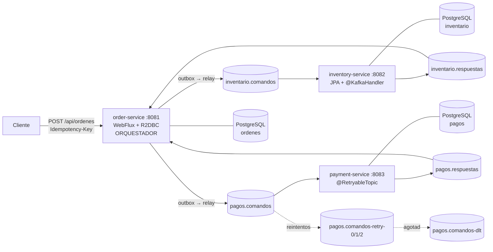
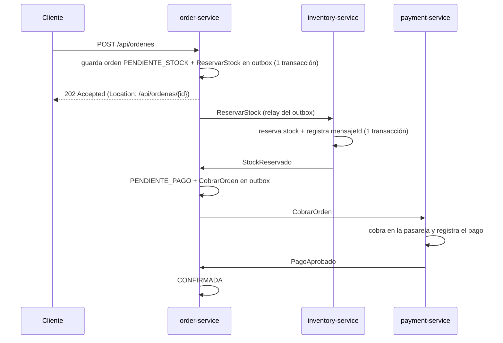
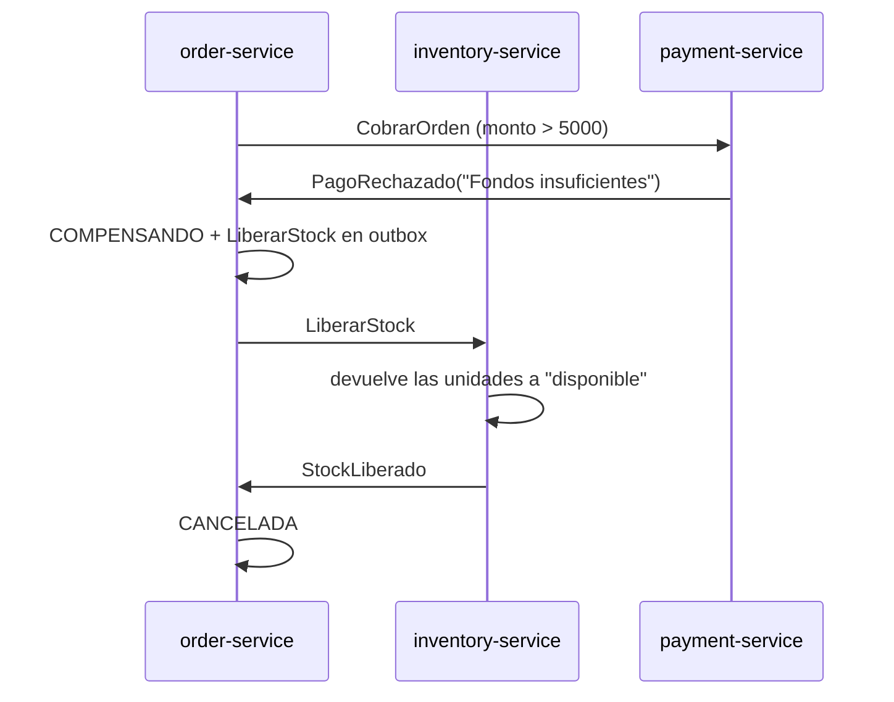

# Checkout con Saga orquestada sobre Spring Kafka

Checkout de una tienda online construido como **tres microservicios** que se coordinan **solo por mensajes**, sin transacciones distribuidas. Reservar el stock y cobrar viven en servicios y bases de datos distintas; si el cobro falla, el stock reservado se devuelve automáticamente (compensación).


| Capa | Tecnología |
|---|---|
| Lenguaje y framework | Java 21, Spring Boot 3.5, Maven multimódulo |
| Mensajería | Apache Kafka (KRaft) con **Spring for Apache Kafka 3.3** |
| order-service | Spring **WebFlux** + **R2DBC** (API y acceso a datos reactivos) |
| inventory-service | Spring MVC + JPA/Hibernate + *virtual threads* |
| payment-service | Spring MVC + JDBC (`JdbcClient`) |
| Base de datos | **PostgreSQL 17**, una base por servicio, migraciones con **Flyway** |
| Pruebas | JUnit 5, AssertJ, `@EmbeddedKafka`, H2 en modo PostgreSQL |
| Operación | Docker Compose, Dockerfile multi-stage, Spring Actuator, GitHub Actions |

## Arquitectura




## Flujos de la saga

### Camino feliz



### Compensación (pago rechazado)



## Requisitos

- Docker y Docker Compose v2
- JDK 21 y Maven 3.9+ (solo para compilar, correr los tests o desarrollar fuera de Docker)

## Ejecutar todo con Docker

```bash
docker compose up --build
```

| Servicio | URL |
|---|---|
| order-service | http://localhost:8081 |
| inventory-service | http://localhost:8082/api/stock |
| payment-service | http://localhost:8083/api/pagos/{ordenId} |
| Kafka UI | http://localhost:8090 |
| Adminer (perfil `tools`) | http://localhost:8085 |

```bash
docker compose --profile tools up -d    # además, Adminer para explorar las tablas
docker compose down                     # apaga y conserva los datos
docker compose down -v                  # apaga y borra los datos (BD y Kafka)
```


